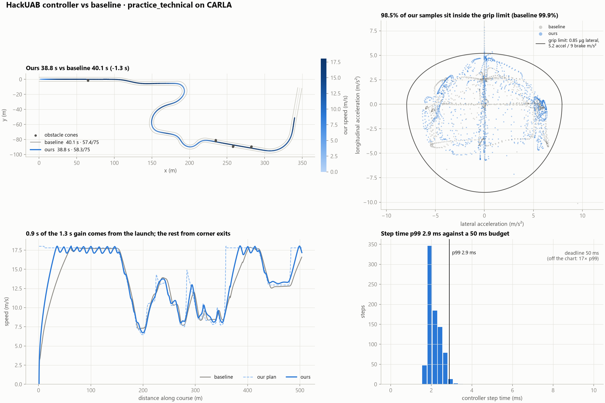
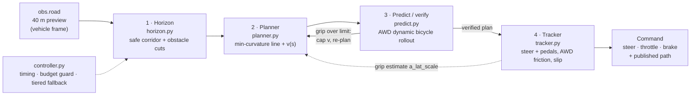

# HackUAB: physics-verified autonomous autocross

**Predictive vehicle control for an autocross course:** a map-free controller that re-plans a minimum-curvature
racing line in the 40 m of road it can see, checks every plan against a dynamic all-wheel-drive bicycle model
before committing to it, and enforces its own friction and visibility limits inside a 50 ms single-core budget,
with a safe fallback when anything fails.



*Hero image: practice_technical on CARLA. This figure was made **before PR #7** (the corner-tracking tracker and
the `lat_accel_frac` 0.6 → 0.75 change) and will be regenerated on the final code: {{FINAL: regenerated figure}}.*

Built at HackBama_01 for the University of Alabama **EcoCAR Innovation Challenge** autonomous-autocross hackathon,
on the organisers' [`mil-sim` harness](https://github.com/dszurek/ecocar-hackathon-sim) (the `simulator/` submodule).

**Visualization app:** {{APP_URL}}. It replays every lap step by step, shows the pipeline's output for one control
cycle, and compares PERFORMANCE and ECO laps. Its data is in [`viz/data/`](viz/data/README.md).

---

## Results

Technical points are the harness's computed score out of 75. All numbers below come from the bicycle backend unless a
column says CARLA. "Cones" counts cone hits; every one of our laps also has 0 off-course events, 0 missed gates
and 0 controller errors.

### Bicycle backend: baseline vs PERFORMANCE vs ECO

| Course | Baseline pure pursuit: lap / cones / points | **PERFORMANCE** (scored default): lap / cones / points | **ECO** (`eco_weight` 0.8): lap / cones / points |
|---|---|---|---|
| practice_technical | 39.47 s / 4 / 57.55 | {{FINAL: 36.73 s}} / {{FINAL: 0}} / {{FINAL: 66.93}} | {{FINAL: 40.59 s}} / {{FINAL: 0}} / {{FINAL: 63.57}} |
| hackathon_test | 55.98 s / 2 / 61.91 | {{FINAL: 49.77 s}} / {{FINAL: 0}} / {{FINAL: 68.58}} | {{FINAL: 54.05 s}} / {{FINAL: 0}} / {{FINAL: 66.06}} |
| practice_basic | 35.86 s / 0 / 66.17 | {{FINAL: 30.23 s}} / {{FINAL: 0}} / {{FINAL: 69.73}} | {{FINAL: 32.27 s}} / {{FINAL: 0}} / {{FINAL: 68.78}} |
| practice_obstacles | 61.21 s / 3 / 59.55 | {{FINAL: 54.33 s}} / {{FINAL: 0}} / {{FINAL: 68.35}} | {{FINAL: 57.76 s}} / {{FINAL: 0}} / {{FINAL: 67.47}} |
| practice_loop | {{TODO: baseline practice_loop lap / cones / points}} | {{TODO: PERFORMANCE practice_loop selftest on the locked main}} | {{TODO: ECO practice_loop selftest on the locked main}} |
| gen-track seed 1 (3 obstacle groups, unseen) | 56.27 s / 4 / 57.85 | {{FINAL: 48.48 s}} / {{FINAL: 0}} / {{FINAL: 69.36}} | {{FINAL: 52.59 s}} / {{FINAL: 0}} / {{FINAL: 66.94}} |
| gen-track seed 2 (unseen) | 67.96 s / 3 / 59.59 | {{FINAL: 61.59 s}} / {{FINAL: 0}} / {{FINAL: 68.51}} | {{FINAL: 63.94 s}} / {{FINAL: 0}} / {{FINAL: 67.56}} |
| gen-track seed 3 (unseen) | 58.64 s / 3 / 59.78 | {{FINAL: 52.50 s}} / {{FINAL: 0}} / {{FINAL: 68.54}} | {{FINAL: 55.18 s}} / {{FINAL: 0}} / {{FINAL: 65.68}} |

Source: `viz/data/index.json`, exported at commit `bad18cd` on the PR #7 controller (`lat_accel_frac` 0.75).
The baseline is the organisers' `controllers/baseline_pure_pursuit.py`; its numbers do not change with our code.

| Step time (bicycle, single core, 50 ms deadline) | Value |
|---|---|
| p99 `step()`, selftest on the locked main | {{FINAL: p99 ms from the final selftest}} |
| Overruns | {{FINAL: 0}} |
| Memory | {{FINAL: ~34 MB}} (measured before PR #7) |

The dataset export ran 4 laps in parallel, which inflates p99 to 13–23 ms, so its step times are not quoted here.
The last serial selftest before PR #7 measured p99 8.2–9.1 ms.

### CARLA backend

| Course | Baseline: lap / points | PERFORMANCE: lap / cones / points | ECO |
|---|---|---|---|
| practice_technical | 40.14 s / 57.4 | {{TODO: CARLA practice_technical on the locked main}} | not measured |
| hackathon_test | 56.95 s / 61.4 | {{TODO: CARLA hackathon_test on the locked main}} | not measured |
| practice_basic | 36.45 s / 65.7 | {{TODO: CARLA practice_basic on the locked main}} | not measured |
| practice_obstacles | 62.06 s / 61.1 | {{TODO: CARLA practice_obstacles on the locked main}} | not measured |
| practice_loop | 95.07 s / 67.2 | {{TODO: CARLA practice_loop on the locked main}} | not measured |

**Pre-PR #7 reference** (`figures/lap_times.csv`, an earlier version of our controller on CARLA): practice_technical
40.13 s / 64.9, hackathon_test 53.03 s / 67.8, practice_basic 33.33 s / 68.9, practice_obstacles 60.20 s / 66.4,
practice_loop 90.12 s / 68.7. These are **not** the submitted code.

---

## Architecture

The car has no map. Every 50 ms it receives the road it can see (up to 40 m ahead, in the vehicle frame) and returns
steering, throttle, brake and the path it intends to drive.



| Module | One line |
|---|---|
| [`hackuab/controller.py`](hackuab/controller.py) | Wires the stages, times each one into `Command.debug`, and degrades one level at a time on an error or a budget overrun (full pipeline → conservative centerline plan → self-contained pure pursuit). |
| [`hackuab/horizon.py`](hackuab/horizon.py) | Turns `obs.road` into a safe corridor: shrinks each side by half the car width plus a margin, and cuts it around obstacles, keeping the wider free side. |
| [`hackuab/planner.py`](hackuab/planner.py) | Re-solves a minimum-curvature racing line inside the corridor every step, then builds a friction-, power- and visibility-limited speed profile, and verifies it with `predict.py`. |
| [`hackuab/predict.py`](hackuab/predict.py) | A batched dynamic single-track model with the same equations as the harness's bicycle backend (AWD split, load transfer, tyre saturation, steering lag), plus `verify_plan`. |
| [`hackuab/tracker.py`](hackuab/tracker.py) | Latency compensation, curvature feedforward + pure-pursuit feedback, PI speed control, the per-axle AWD friction envelope, and online slip adaptation. Throttle and brake are never both on. |
| [`hackuab/params.py`](hackuab/params.py) | Every tunable and the vehicle-model constants, plus the two driving modes (`MODES`). |
| [`hackuab/performance.yaml`](hackuab/performance.yaml), [`hackuab/eco.yaml`](hackuab/eco.yaml) | The two mode configs. No config means PERFORMANCE. |

Outside the scored controller: `tools/` (energy meter, Pareto sweep, figures, viz export), `fusion/` (sensor-fusion
tool), `viz/data/` (the app's dataset), `tests/` (pytest, synthetic road models and full simulator laps).

---

## Innovations

Each one is described with the maths, why it matters, and a measured number in **[docs/INNOVATION.md](docs/INNOVATION.md)**.

1. **Minimum-curvature racing line re-solved every 50 ms** inside the 40 m corridor (a 41 × 41 bounded least-squares solve).
2. **Physics-verified speed profile:** forward/backward friction passes, then a dynamic AWD bicycle-model rollout
   (`predict.verify_plan`) that lowers speed wherever the predicted grip use exceeds the limits.
3. **Horizon-end visibility guard:** the car can always stop for a hairpin hidden just past what it can see.
4. **AWD per-axle friction model** in the tracker: 40/60 drive split, 60/40 brake split, load transfer.
5. **Online understeer/slip adaptation:** measured vs expected yaw rate and rear slip shrink the usable grip.
6. **Obstacle-aware corridor reshaping** and a **blocked-road safety stop** (creep, never full throttle at a wall).
7. **Two driving modes on one knob, PERFORMANCE vs ECO,** with an energy meter whose force model mirrors the
   simulator and closes the energy balance, plus a measured Pareto front.
8. **Sensor-fusion tool** (lidar + radar + camera → cones, pure numpy). Not part of the scored controller.

---

## How to run

**Requirements:** Windows or Linux, **Python 3.10–3.12** (CARLA wheels do not support 3.13+). The controller itself uses
only numpy and the standard library.

### Setup (once)

```powershell
git clone --recurse-submodules https://github.com/rmaytr/HackUAB.git
cd HackUAB
git config core.longpaths true          # Windows: avoids "Filename too long"
cd simulator
powershell -ExecutionPolicy Bypass -File scripts\setup.ps1
.venv\Scripts\Activate.ps1
```

Already cloned without the submodule? Run `git submodule update --init --recursive`.

### Drive a lap (from `simulator/`)

```powershell
python ..\tools\run_mode.py performance run practice_technical --view   # fastest lap, the scored default
python ..\tools\run_mode.py eco run practice_technical --view           # energy-optimal lap
python ..\tools\run_mode.py performance run practice_technical --backend carla
```

Any extra `autocross` flags pass through (`--strict` re-raises module errors instead of using the fallback).
The equivalent raw harness call is
`python -m autocross run -c ..\hackuab\controller.py -t tracks\practice_technical.yaml --backend bicycle --view`.

### Test

```powershell
python ..\tools\run_mode.py performance selftest        # all public courses, PERFORMANCE
python ..\tools\run_mode.py eco selftest                # all public courses, ECO
python -m autocross selftest -c ..\hackuab\controller.py   # required before any merge to main
python -m pytest ..\tests -q                            # every test
python -m pytest ..\tests -m performance                # PERFORMANCE-mode tests
python -m pytest ..\tests -m eco                        # ECO-mode tests ("eco and not sim" skips full laps)
```

Check generalisation on unseen courses with
`python -m autocross gen-track --seed 1 --obstacles 3 --out <path outside simulator>\seed1.yaml` (try several seeds).
Each run writes `runs/<stamp>_<team>_<course>/` with `report.png`, `telemetry.csv` (our `dbg_*` columns included),
`events.json` and `summary.json`.

---

## Honest notes

- **Energy figures are estimates.** The simulator has no battery, electric drivetrain or regen. Our energy meter
  (`tools/energy.py`) rebuilds wheel-level energy exactly from the bicycle model's forces, then converts to battery
  energy with **assumed** values: `eta_drive` = 0.90, `eta_regen` = 0.65, `P_regen_max` = 60 kW. **These are generic
  EV assumptions, not Chevy Blazer EV specifications.** Change them with the meter's CLI flags.
- **CARLA:** ECO mode and the energy meter have not been run on CARLA (CARLA telemetry has no pedal-to-force model to
  mirror). The final PERFORMANCE code has {{FINAL: not yet / been}} validated on CARLA; the CARLA figures in
  `figures/` predate PR #7.
- **Figures:** every PNG in `figures/` and `tools/figures/` was made before PR #7 unless regenerated: {{FINAL: regenerated figures}}.
  The Pareto front in `tools/figures/eco_pareto.png` is from the pre-PR #7 controller.
- **Known limitation:** on two extra unseen courses (gen-track seeds 4 and 5) the pre-PR #7 controller hit one
  obstacle cone each. The cause is in the obstacle handling (when the corridor is invalid, the verifier does not
  check containment), not in the course. We did not add a course-specific workaround.
  {{TODO: re-run seeds 4 and 5 on the locked main}}
- **The verifier is not a containment guarantee:** it checks grip use, commanded grip demand and rear slip, but the
  planner does not yet pass it the corridor.
- **Sensor fusion** was only run on synthetic frames. Its CARLA capture path has not been exercised.

---

## Team

| Who | Built |
|---|---|
| **Rodion** | Racing line, speed profile and visibility guard (`planner.py`), dynamic model and verifier (`predict.py`), ECO mode and energy meter, visualization app |
| **Saisi** | Safe corridor and obstacle handling (`horizon.py`), sensor-fusion tool (`fusion/`) |
| **Viraj** | Integration and fallback (`controller.py`, `params.py`), tracker and AWD friction model (`tracker.py`), tools and figures, CARLA runs |

Repository: <https://github.com/rmaytr/HackUAB> · Simulator: <https://github.com/dszurek/ecocar-hackathon-sim>
