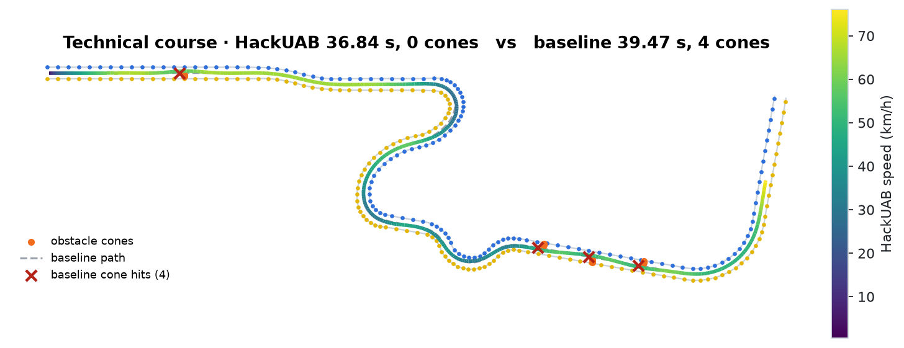
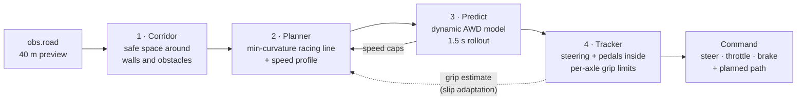
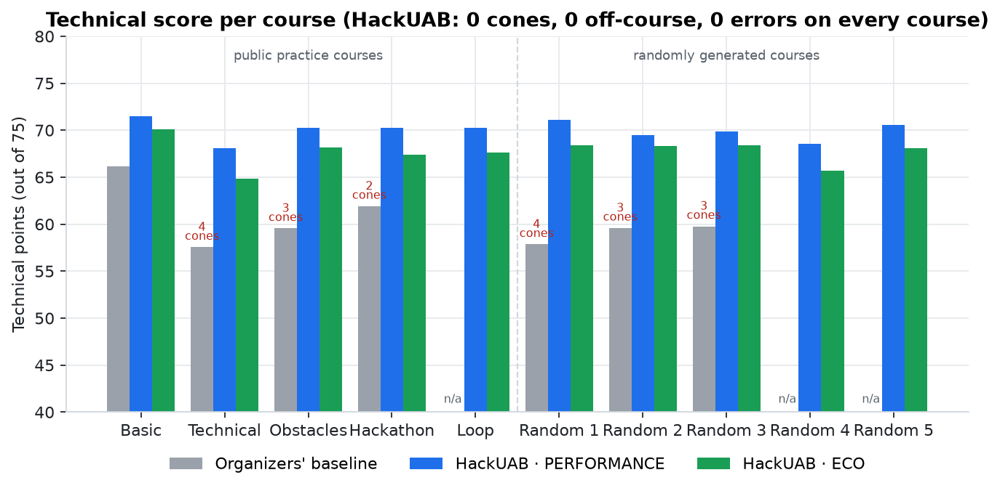
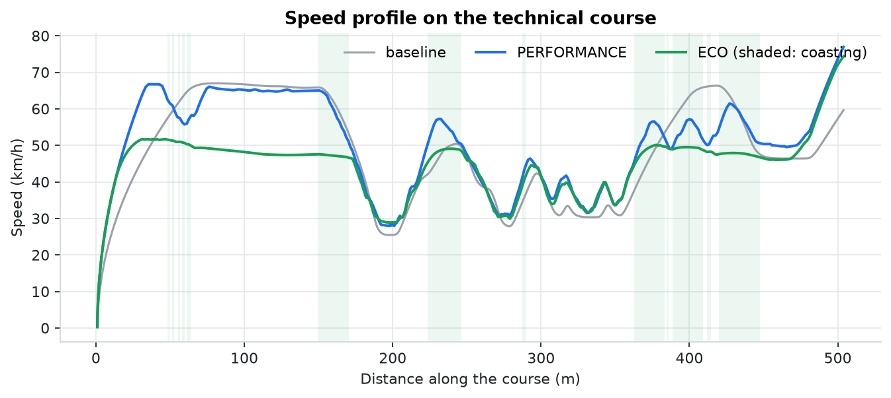
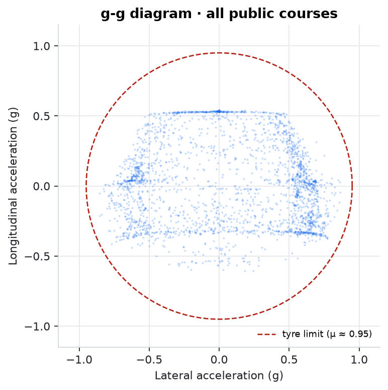
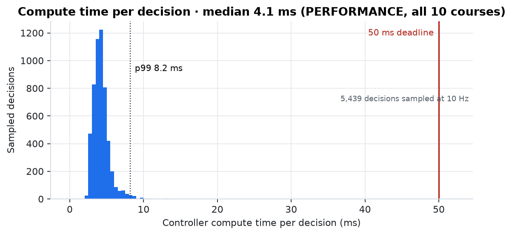
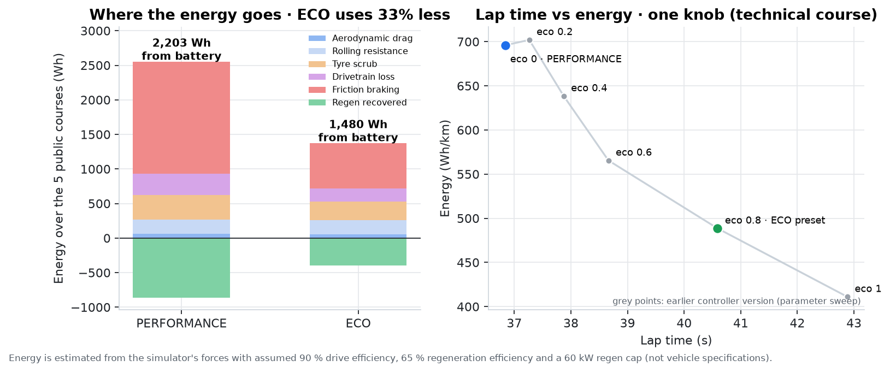
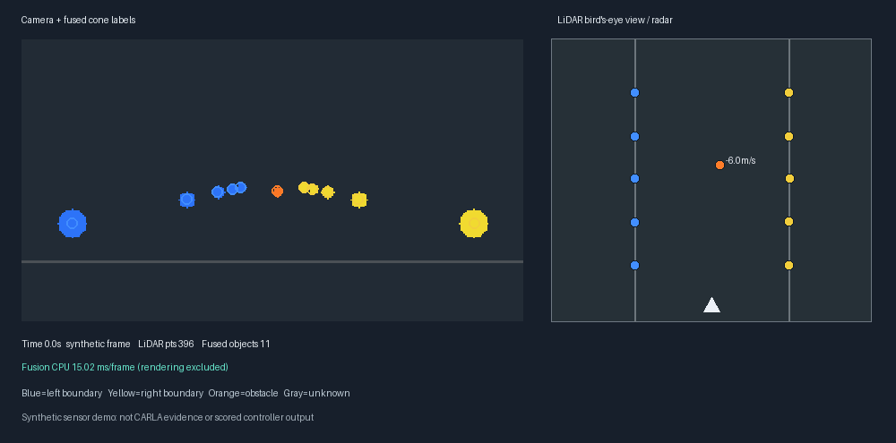

<div align="center">

# HackUAB · Physics-Verified Autonomous Autocross

**A map-free racing controller for an all-wheel-drive electric vehicle that sees 40 m of track, decides 20 times
per second, and checks every plan against a physics model before it drives it.**

🏆 **1st place, HackBama_01 (University of Alabama), EcoCAR autocross challenge**

[](#getting-started)
[](hackuab/)
[](https://carla.org/)
[](tests/)
[](https://youtu.be/a-963WiK0cQ)
[](https://uab-track-sync.base44.app)



</div>

## Highlights

- **0 cones, 0 off-course, 0 missed gates and 0 controller errors** on all 5 public courses and 5 randomly generated
  courses, in both driving modes.
- **Faster and cleaner than the organizers' baseline:** 36.8 s vs 39.5 s on the technical course with 0 cone hits
  instead of 4, and **+10.5 technical points** (68.1 vs 57.6 / 75).
- **~70 / 75 technical points** on average across public and unseen courses.
- **~4 ms median compute per decision** (p99 ≈ 7–11 ms) against a 50 ms real-time budget, in pure NumPy on one core.
- **Two driving modes, one knob:** ECO uses **33 % less estimated battery energy for 8 % more lap time**, still
  penalty-free.
- **Every plan is physics-checked:** a dynamic AWD vehicle model predicts the next 1.5 s and slows the plan wherever
  the tyres would slide.

| | |
|---|---|
| ▶️ **Demo video (3 min)** | [youtu.be/a-963WiK0cQ](https://youtu.be/a-963WiK0cQ) |
| 📊 **Interactive visualizer** | [uab-track-sync.base44.app](https://uab-track-sync.base44.app): replays every lap step by step and compares the two modes |

## The challenge

The EcoCAR Innovation Challenge autocross event, run as a 12-hour hackathon on the organizers'
[CARLA-based simulation harness](https://github.com/dszurek/ecocar-hackathon-sim):

- **No map.** Every 50 ms the car receives only a processed perception model of the next **40 m** of a cone-lined
  course, plus its own state.
- **Hard real time.** `step()` must return steering, throttle and brake within **50 ms**, on **1 CPU core, no GPU,
  1 GB**, inside a sandbox (no files, network or subprocesses).
- **Unseen courses.** Scoring uses unreleased tracks on two backends, CARLA and a dynamic bicycle model, so the
  controller has to generalise instead of memorising the practice courses.
- **Score:** 75 computed points (lap time 30, path tracking 15, compute 15, physical realism 15) plus 25 judged
  innovation points. Cone hits, leaving the course and missed gates are penalised.

## How it works



| Stage | Module | What it does |
|---|---|---|
| **1 · Corridor** | [`horizon.py`](hackuab/horizon.py) | Shrinks the visible road by the car's width plus a margin and carves around obstacle cones, choosing the wider gap with hysteresis so the car never flip-flops sides. |
| **2 · Planner** | [`planner.py`](hackuab/planner.py) | Solves a **minimum-curvature racing line** inside the corridor every step (regularised least squares, warm-started), then a grip-limited speed profile with power-limited acceleration, braking passes and a **visibility guard** for corners hidden beyond 40 m. |
| **3 · Predict** | [`predict.py`](hackuab/predict.py) | Rolls a **dynamic single-track model of the AWD car** (tyre saturation, load transfer, 40/60 drive split, steering lag, drag) 1.5 s ahead with the tracker's own control law, and caps speed where predicted tyre use or rear slip exceeds the limits. |
| **4 · Tracker** | [`tracker.py`](hackuab/tracker.py) | Curvature feedforward plus pure-pursuit feedback with latency compensation; an **AWD per-axle traction model** (like traction control and ABS) bounds throttle and brake; **online slip adaptation** reduces the grip the planner relies on when the car understeers. |
| **Integration** | [`controller.py`](hackuab/controller.py) | Wires the stages, times each one, publishes the planned path, and falls back to cheaper control if a stage fails or runs over budget. A blocked road triggers a braking plan instead of acceleration. |

Read the full design in **[docs/ARCHITECTURE.md](docs/ARCHITECTURE.md)** and what makes it novel in
**[docs/INNOVATION.md](docs/INNOVATION.md)**.

## Results



| Course | Baseline (time · cones · points) | **PERFORMANCE** (time · points) | **ECO** (time · points) |
|---|---|---|---|
| Practice: technical | 39.47 s · 4 · 57.55 | **36.84 s · 68.08** | 40.59 s · 64.87 |
| Practice: basic | 35.86 s · 0 · 66.17 | **30.23 s · 71.48** | 32.27 s · 70.08 |
| Practice: obstacles | 61.21 s · 3 · 59.55 | **54.33 s · 70.24** | 57.76 s · 68.16 |
| Hackathon test | 55.98 s · 2 · 61.91 | **49.77 s · 70.25** | 54.09 s · 67.37 |
| Practice: loop | not measured | **86.01 s · 70.28** | 93.24 s · 67.61 |
| Random courses 1–5 | cone hits on all 3 measured | **69.90 mean** | 67.79 mean |

Our runs: **0 penalties of any kind on all 20 laps** (10 courses × 2 modes), bicycle backend. Full tables, method
and known limits are in **[docs/RESULTS.md](docs/RESULTS.md)**.

<table>
<tr>
<td width="62%"></td>
<td width="38%"></td>
</tr>
<tr>
<td><sub>Speed along the technical course. PERFORMANCE carries more speed through corners; ECO coasts (shaded) before braking zones.</sub></td>
<td><sub>Every sampled acceleration stays inside the tyre's friction circle.</sub></td>
</tr>
</table>



## Two driving modes, one knob

The same controller exposes a single parameter, `eco_weight`. **PERFORMANCE** (`0`, the scored default) drives the
fastest legal lap. **ECO** (`0.8`) lifts and coasts before braking zones, accelerates more gently and cruises slower.
An energy meter in [`tools/energy.py`](tools/energy.py) mirrors the simulator's force model, so the trade-off is
measured rather than guessed.



> Energy is estimated from simulated wheel forces with assumed 90 % drive efficiency, 65 % regeneration efficiency
> and a 60 kW regen cap. These are model assumptions, not vehicle specifications.

## Sensor-fusion prototype

The scored controller receives an already-processed road model, so perception isn't part of the score. To show the
full stack, [`fusion/`](fusion/) adds an offline **camera + LiDAR + radar** fusion pipeline (ground filtering, LiDAR
clustering, camera colour classification, radar association) that turns raw sensor frames into the controller's own
cone and obstacle inputs, at about 1.4 ms per frame on synthetic data.



## Getting started

Requires **Python 3.10–3.12** (the CARLA client doesn't support 3.13+). The organizers' simulator is a pinned git
submodule; CARLA itself is only needed for the CARLA backend.

```bash
git clone --recurse-submodules https://github.com/rmaytr/HackUAB.git
cd HackUAB/simulator
powershell -ExecutionPolicy Bypass -File scripts\setup.ps1     # Linux/macOS: ./scripts/setup.sh
```

Drive a lap with a live top-down view (from `simulator/`):

```bash
.venv\Scripts\python.exe ..\tools\run_mode.py performance run practice_technical --view
.venv\Scripts\python.exe ..\tools\run_mode.py eco run practice_technical --view
```

Score every public course with the official settings, then run the tests from the repository root:

```bash
.venv\Scripts\python.exe ..\tools\run_mode.py performance selftest
cd .. && simulator\.venv\Scripts\python.exe -m pytest tests -q
```

On Linux/macOS use `.venv/bin/python` and forward slashes. More commands are in [tools/README.md](tools/README.md).

## Repository layout

```text
hackuab/      The submitted controller: controller, horizon, planner, predict, tracker, params, mode YAMLs
tests/        pytest suite: unit, regression (golden commands) and full simulated-lap tests
tools/        Development tools: run modes, sweeps, energy meter, plotting, dataset export
fusion/       Offline camera + LiDAR + radar fusion prototype and demos
viz/data/     Precomputed lap dataset that powers the web visualizer
docs/         Architecture, innovations, results and figures
simulator/    Organizers' simulation harness (git submodule, unmodified)
```

## Team

Built in 12 hours at **HackBama_01** by team **HackUAB**:

- **Rodion:** racing-line planner, physics-based prediction and verification, ECO mode and energy analysis,
  web visualizer, integration
- **Saisi:** obstacle-aware corridor, sensor-fusion prototype
- **Viraj:** tracking controller and AWD traction model, controller integration, CARLA validation and tooling

## Acknowledgements

Simulation harness, scoring and practice courses by the hackathon organizers:
[dszurek/ecocar-hackathon-sim](https://github.com/dszurek/ecocar-hackathon-sim), built on
[CARLA](https://carla.org/). Thanks to the EcoCAR Innovation Challenge and HackBama for hosting.
