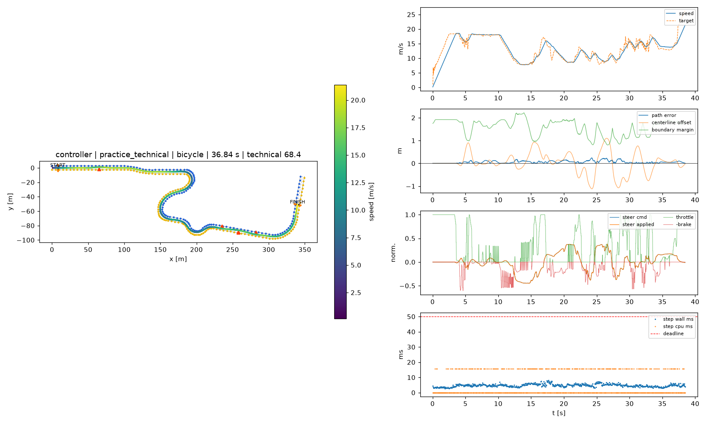
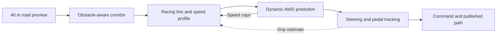

# HackUAB: physics-verified autonomous autocross

A map-free controller that plans a racing line from 40 m of visible road, checks predicted tyre loads with an AWD vehicle model, and controls steering and pedals every 50 ms.

**Final selected result:** verifier-enabled code `e3b8a28`, promoted to `main` at Rodion's request on 2026-10-17. PERFORMANCE is the submission default; ECO is selected through its config. The simulator remains pinned and unchanged.



## Final measured results

Single-core bicycle backend, serial validation, no completed lap repeated: **129 tests passed**, and **22 standalone laps finished with zero cone hits, obstacle hits, off-course events, missed gates or controller errors**. This covers strict technical/obstacle checks, both public selftests and seeds 1-5 with three obstacle groups in both modes.

| Course | PERFORMANCE: seconds / technical points | ECO: seconds / technical points |
|---|---:|---:|
| hackathon_test | 49.766 / 70.25 | 54.092 / 67.37 |
| practice_basic | 30.227 / 71.48 | 32.272 / 70.08 |
| practice_loop | 86.010 / 70.28 | 93.240 / 67.61 |
| practice_obstacles | 54.329 / 70.24 | 57.761 / 68.16 |
| practice_technical | 36.840 / 68.08 | 40.591 / 64.87 |
| seed 1 | 48.243 / 71.07 | 52.592 / 68.43 |
| seed 2 | 61.587 / 69.45 | 64.010 / 68.33 |
| seed 3 | 52.497 / 69.89 | 55.181 / 68.43 |
| seed 4 | 57.390 / 68.57 | 59.770 / 65.67 |
| seed 5 | 49.402 / 70.53 | 53.386 / 68.09 |

Public mean technical points: **70.066/75 PERFORMANCE**, **67.618/75 ECO**. Generated-course means: **69.902/75 PERFORMANCE**, **67.790/75 ECO**. These public-course averages are not the official score on the weighted unreleased courses.

PERFORMANCE p99 step times were **6.957-10.597 ms**, with zero overruns or soft-budget trips. ECO p99 was **6.557-10.695 ms**; seed 2 had one hard overrun (**52.060 ms maximum**) and one soft-budget trip, while seed 4 had another soft-budget trip. Those results are retained. Initial OS permission failures are also recorded in [STATUS](docs/STATUS.md).

## What we built



- **Racing line:** a bounded minimum-curvature solve with warm starts keeps the published path smooth across decisions.
- **Speed planning:** cornering limits, power-limited acceleration, backward braking and a visibility guard for an unseen tight corner. Only the speculative guard is released when the finish becomes visible.
- **Prediction remains enabled:** a 1.5 s dynamic bicycle rollout at 50 ms resolution checks predicted tyre use, commanded grip demand and rear slip, then returns local speed caps.
- **AWD-aware tracking:** per-axle grip limits, load transfer, steering lag/delay compensation, curvature feedforward, speed PI control and slip adaptation. Throttle and brake are mutually exclusive.
- **Obstacle handling and fallback:** reshape the corridor around obstacles; a blocked corridor selects a braking/creep plan. Module failures or soft-budget trips select cheaper control paths.
- **PERFORMANCE and ECO:** ECO adds lift-and-coast, gentler acceleration and lower cruise speed; both modes retain prediction.
- **Diagnostics and replay:** per-stage telemetry, reports, an energy meter and [visualization datasets](viz/data/README.md).
- **Offline sensor fusion:** camera, LiDAR and radar processing plus a bridge into controller observations. This demo is separate from the scored controller, whose API supplies a processed road model.

See [INNOVATION](docs/INNOVATION.md) for implementation details and evidence.

## Improvements

The original pure-pursuit technical-course reference was **39.47 s, four cone hits, 57.55/75**. The final PERFORMANCE public run was **36.840 s, zero cones, 68.08/75**: about **6.7% faster**, with four fewer collisions and about **10.5 more points**. The complete development changed planning, tracking and tuning; this comparison does not isolate the final compute patch.

The final patch reduces repeated calculation while retaining the verifier and its limits: bounded exact AWD-envelope caches, cached acceleration tables/tangents, shared interpolation lookups and scalar slip-state calculations. Regression tests retain exact cached/helper and tracker parity. Paired diagnostics measured cold/warm verifier median **2.930/0.866 ms on main versus 1.692/0.613 ms** after optimization (about **42%/29% lower**). These are microbenchmarks, not full-lap guarantees.

Compared with the prior recorded candidate, the public mean rose **68.294 to 70.066/75** in PERFORMANCE and **67.490 to 67.618/75** in ECO. The earlier PERFORMANCE obstacle timing failure remains in STATUS; there was no fresh paired main sweep.

On these final five public runs, ECO's estimated battery energy was **32.85% lower** for **8.08% more total lap time** (2203.49 versus 1479.66 Wh). These are model-based estimates using assumed 90% drive efficiency, 65% regeneration efficiency and a 60 kW regen cap, not vehicle specifications or measured CARLA battery use.

## Run it

Use Python **3.10-3.12**. From a clone with submodules:

```powershell
git submodule update --init --recursive
cd simulator
powershell -ExecutionPolicy Bypass -File scripts\setup.ps1
.venv\Scripts\python.exe ..\tools\run_mode.py performance run practice_technical --view
.venv\Scripts\python.exe ..\tools\run_mode.py eco run practice_technical --view
.venv\Scripts\python.exe ..\tools\run_mode.py performance selftest
.venv\Scripts\python.exe ..\tools\run_mode.py eco selftest
```

Run the full tests from the repository root so the fusion package is importable:

```powershell
simulator\.venv\Scripts\python.exe -m pytest tests -q
simulator\.venv\Scripts\python.exe -m fusion.demo --full-controller --frames 6
```

The judged submission is `hackuab/`: controller, horizon, planner, predictor, tracker, parameters and mode YAMLs. Controller imports are NumPy and the Python standard library. `tools/`, `fusion/`, `viz/` and documentation support development and the demo.

## Known limits and provenance

- Exact-code CARLA validation remains outstanding. Rodion's reported **69.9/75 CARLA** belongs to the earlier integrated main; final bicycle results cannot establish a CARLA improvement.
- PERFORMANCE rear slip reached **6.898 degrees on basic** and **7.906 degrees on seed 2**, above the scorer's 6-degree threshold. ECO seed-4 committed-path error reached **1.125 m**. Zero driving penalties does not mean every dynamics/runtime criterion passed.
- The planner does not pass the corridor into verification, so verification does not certify corridor containment. Predictor PI/jerk history also starts afresh instead of receiving the full live tracker state.
- The visibility guard and blocked-road creep reduce risk; neither guarantees stopping or collision avoidance in every unseen situation. Known jerk-limit, understeer-estimate and narrow-road issues remain documented in STATUS.
- The visualization's two default presets now use final saved telemetry. Other parameter sweeps/baselines remain historical and carry per-run commit provenance. Older figures elsewhere in the repo remain historical; the report above is from the final validation.

Full validation tables, timing failures, historical comparisons and next checks are in [docs/STATUS.md](docs/STATUS.md). Submission scope is in [docs/SUBMISSION.md](docs/SUBMISSION.md).

Team: **Rodion** (planning/prediction), **Saisi** (corridor/fusion), **Viraj** (integration/tracking/CARLA/tooling).
