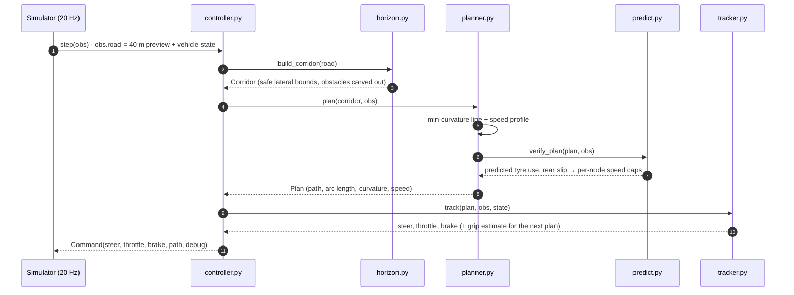

# Architecture

The submitted controller is the [`hackuab/`](../hackuab) package: about 1,700 lines of Python that depend only on
NumPy and the standard library, as the competition sandbox requires. The simulator loads
[`controller.py`](../hackuab/controller.py) and calls `step(obs)` every 50 ms.

## Control loop



All geometry is in the **vehicle frame** (x forward, y left; positive steering, curvature and yaw rate mean left),
in metres, seconds and radians.

## Stage 1: corridor (`horizon.py`)

Turns the perceived road (`obs.road`: centerline, left/right widths and obstacles over the next 40 m) into the space
the car's reference point may occupy.

- **Wall clearance.** Each side shrinks by half the vehicle width plus `corridor_margin` (0.3 m), never below a
  minimum band.
- **Obstacles.** For every obstacle the module measures the free gap on each side, picks the wider one and narrows
  the band there. The cut ramps in over `obstacle_taper_m` so the path shifts smoothly. When the two gaps are
  similar, it keeps the side the car is already on (hysteresis), so it never flip-flops.
- **Pinch handling.** Where the band closes, the car drives the middle of the gap. The corridor is marked
  `valid=False` only if the car would not fit even with zero margin.

## Stage 2: planner (`planner.py`)

**Racing line.** The unknowns are lateral offsets `n_i` along the corridor normals at ~1 m spacing, bounded by the
corridor. Curvature is close to linear in `n` for small offsets, so the minimum-curvature line is a small regularised
least-squares problem (a 41 × 41 linear solve). Extra terms:

- tie the start of the line to the car's current offset and heading;
- penalise curvature changes, for smooth steering;
- pull towards the previous step's solution (warm start), so the published path doesn't jump between decisions,
  which protects the path-tracking score;
- fade the offset back to the centerline near the end of the horizon, so the car never commits to an apex it
  can't see yet.

Bounds are enforced by re-solving two or three times with violated bounds pinned (a cheap projected active-set
method).

**Speed profile.** From the line's curvature κ:

1. **Cornering cap:** `v ≤ sqrt(a_lat / |κ|)`, with `a_lat = lat_accel_frac · μ · g`.
2. **Visibility guard:** the speed at the 40 m horizon is capped as if a tight hairpin started just beyond it, and a
   backward pass carries that constraint toward the car. Once the finish is visible, only this speculative cap is
   released.
3. **Backward (braking) pass** and **forward (acceleration) pass.** The forward pass is power-limited and includes
   drag, rolling resistance and the AWD traction limit. Both run in O(K).
4. **ECO shaping** (`eco_weight > 0`): lift-and-coast before braking zones, a gentler acceleration fraction and a
   lower cruise speed.

## Stage 3: prediction and verification (`predict.py`)

A **dynamic single-track ("bicycle") model** of the car mirrors the simulator's bicycle backend:

- tyre lateral force from cornering stiffness per unit load, saturating at μ·F<sub>z</sub>, with a friction circle
  per axle;
- static load split plus longitudinal load transfer from the CG height;
- AWD drive split (40 % front / 60 % rear) and brake split (60 % front), with per-axle traction control;
- drive force limited by power; drag and rolling resistance;
- the steering actuator's slew-rate limit and first-order lag;
- a linearly implicit update for the stiff tyre modes, so it stays stable at the 50 ms control step.

`verify_plan()` rolls this model 1.5 s ahead, following the plan with a scalar copy of the tracker's control law.
Wherever predicted tyre utilisation, commanded grip demand or rear-axle slip exceeds its limit, it returns per-node
speed caps. The planner applies them and re-plans (one extra iteration). Caps relax over later steps, so a single
conservative prediction doesn't slow the car permanently.

## Stage 4: tracker (`tracker.py`)

1. **Latency compensation:** predicts where the car will be when the command takes effect and tracks from there.
2. **Steering:** curvature feedforward read slightly ahead (the car's yaw lags the wheel), plus pure-pursuit feedback
   on the tracking error only. A grip cap and a slew limit keep the command physical.
3. **Speed:** feedforward acceleration from the speed profile plus PI control; the integral is suppressed when
   clearly over speed so it can't fight braking into a corner.
4. **AWD per-axle traction envelope:** the largest acceleration and braking for which *both* axles stay inside their
   friction circles, given the cornering load, drive and brake splits and load transfer. Jerk limiting smooths the
   pedals. **Throttle and brake are never applied together.**
5. **Online slip adaptation:** compares expected yaw rate `v/L·tan δ` with the measured one, and watches rear-axle
   slip. When the tyres saturate it shrinks the grip estimate (`a_lat_scale`), which the planner uses on the next
   step, then recovers it slowly.

## Integration and safety (`controller.py`)

- **Per-stage timing** (`t_horizon_ms`, `t_plan_ms`, `t_track_ms`, `t_total_ms`) and planner diagnostics are
  published through `Command.debug` and land in the simulator's telemetry.
- **Graceful degradation**, reported as `debug.fallback`:
  - **0:** full pipeline.
  - **1:** the corridor or planner failed, returned invalid output, or the previous step ran over the compute
    budget, so the tracker drives a conservative centerline plan.
  - **2:** the tracker itself failed, so a self-contained pure-pursuit controller takes over.

  A bug therefore costs speed, never a crash.
- **Blocked road:** if obstacles leave no gap (`Corridor.valid=False`), the planner returns a braking plan to a 2 m/s
  creep before the blockage instead of accelerating.
- **Output sanitising:** every command is clipped and NaN-free.
- **Strict mode** (`strict: true` in a config) re-raises errors during development instead of falling back.

## Driving modes and parameters

All tunables live in [`params.py`](../hackuab/params.py). A `--controller-config` YAML picks a mode and can override
any field:

| Mode | Config | `eco_weight` | Purpose |
|---|---|---|---|
| PERFORMANCE | none, or [`performance.yaml`](../hackuab/performance.yaml) | 0.0 | Fastest legal lap (scored default) |
| ECO | [`eco.yaml`](../hackuab/eco.yaml) | 0.8 | Energy-optimal lap |

An unknown mode name raises at start-up rather than silently driving the wrong profile.

## Data contracts

```python
@dataclass
class Corridor:            # horizon.build_corridor(road, vehicle, params)
    s: np.ndarray          # (K,)  station along the centerline, 0..40 m
    center: np.ndarray     # (K,2) centerline points
    normal: np.ndarray     # (K,2) unit left normals
    left: np.ndarray       # (K,)  usable offset to the left  (margins removed)
    right: np.ndarray      # (K,)  usable offset to the right (margins removed)
    valid: bool            # False if the car cannot fit through

@dataclass
class Plan:                # planner.plan(corridor, obs, vehicle, params)
    path: np.ndarray       # (N,2) the driven line; published as Command.path
    s: np.ndarray          # (N,)  arc length along the path
    kappa: np.ndarray      # (N,)  signed curvature, + = left
    v: np.ndarray          # (N,)  target speed
    debug: dict            # scalar diagnostics merged into Command.debug

def track(plan, obs, vehicle, params, state) -> tuple[float, float, float]:
    """(steer, throttle, brake): clipped, NaN-free, throttle and brake never both > 0."""
```

## Testing

[`tests/`](../tests) covers each stage in isolation (synthetic road models), cross-checks the predictor against the
tracker and the simulator's telemetry, and runs full simulated laps. Golden-file regression tests pin the
PERFORMANCE command sequence bit for bit, so an ECO or refactoring change can't silently alter the scored behaviour.
Tests are tagged by mode:

```bash
python -m pytest tests -q                    # everything
python -m pytest tests -m performance        # PERFORMANCE mode only
python -m pytest tests -m "eco and not sim"  # fast ECO unit tests
```
