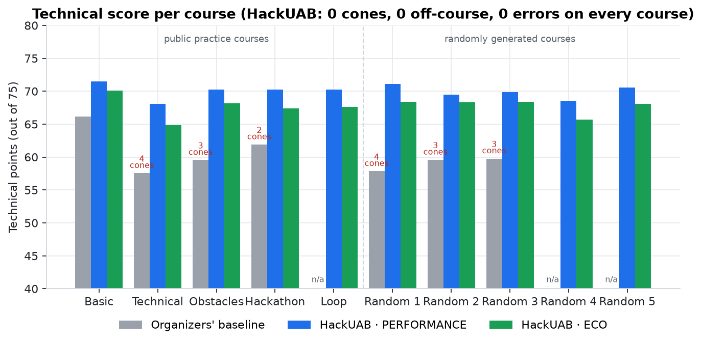
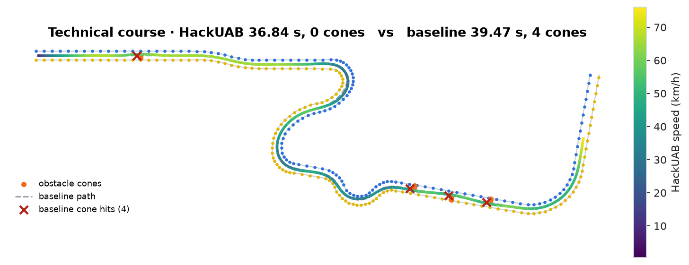
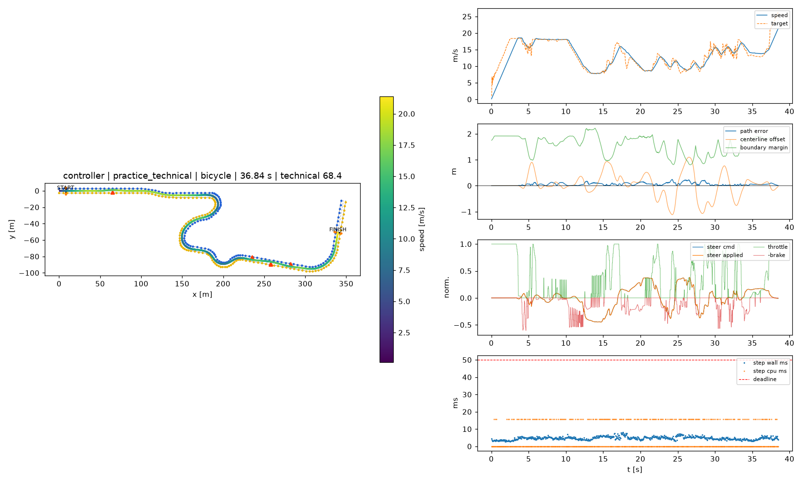
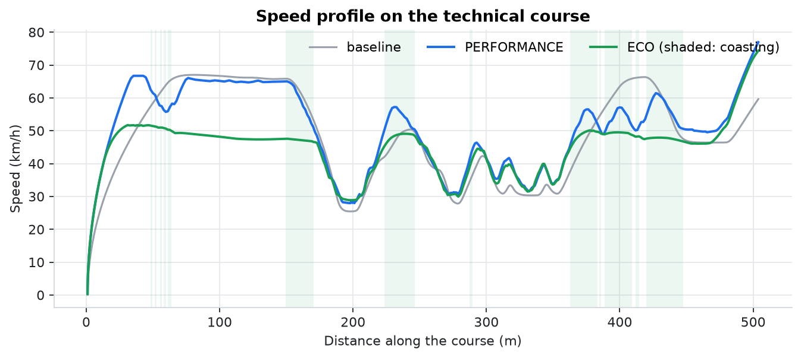
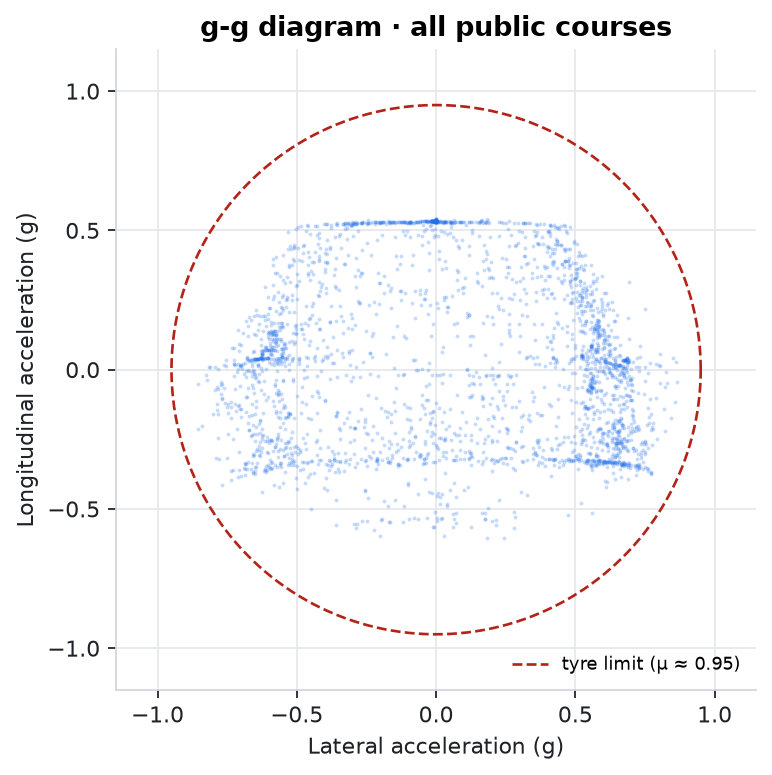
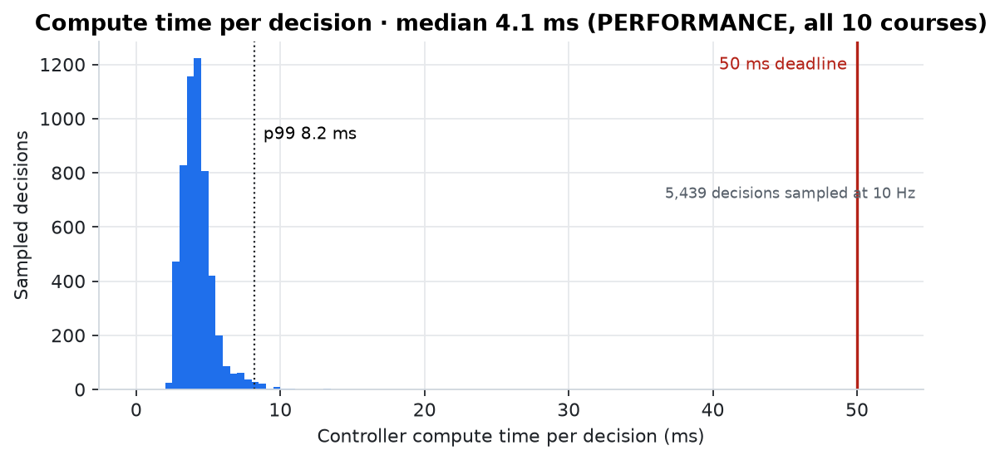
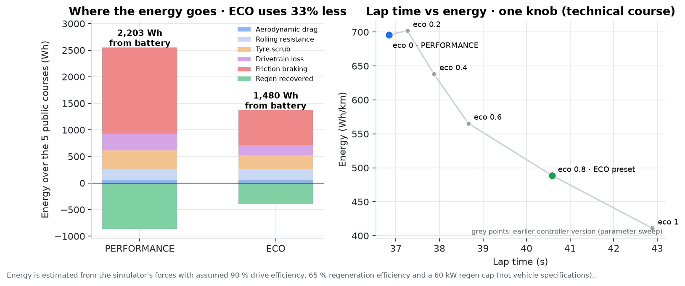

# Results

All numbers come from the final submitted controller, measured on the organizers' harness with the **official
settings**: bicycle backend, one-core sandbox, 50 ms deadline. Every lap was run once, serially, and no lap was
rerun to pick a better result. Figures are generated from the published dataset by
[`tools/make_readme_figures.py`](../tools/make_readme_figures.py).

## Summary

| Metric | PERFORMANCE | ECO |
|---|---|---|
| Laps finished | 10 / 10 | 10 / 10 |
| Cone hits · obstacle hits · off-course · missed gates · controller errors | **0 · 0 · 0 · 0 · 0** | **0 · 0 · 0 · 0 · 0** |
| Mean technical points, 5 public courses | **70.07 / 75** | 67.62 / 75 |
| Mean technical points, 5 random courses | **69.90 / 75** | 67.79 / 75 |
| Total lap time, 5 public courses | **257.2 s** | 278.0 s |
| Estimated battery energy, 5 public courses | 2,203 Wh | **1,480 Wh (−33 %)** |
| p99 compute time per decision | 7.0–10.6 ms | 6.6–10.7 ms |

The full test suite (129 tests: unit, golden regression and full simulated laps) passes on the final code.

## Against the organizers' baseline

The harness ships a reference controller (pure pursuit on the centerline, which ignores obstacles).

| Course | Baseline | HackUAB PERFORMANCE | Change |
|---|---|---|---|
| Practice: technical | 39.47 s · 4 cones · 57.55 pts | **36.84 s · 0 cones · 68.08 pts** | −6.7 % time, +10.5 pts |
| Practice: basic | 35.86 s · 0 cones · 66.17 pts | **30.23 s · 0 cones · 71.48 pts** | −15.7 % time, +5.3 pts |
| Practice: obstacles | 61.21 s · 3 cones · 59.55 pts | **54.33 s · 0 cones · 70.24 pts** | −11.2 % time, +10.7 pts |
| Hackathon test | 55.98 s · 2 cones · 61.91 pts | **49.77 s · 0 cones · 70.25 pts** | −11.1 % time, +8.3 pts |
| Random course 1 | 56.27 s · 4 cones · 57.85 pts | **48.24 s · 0 cones · 71.07 pts** | −14.3 % time, +13.2 pts |
| Random course 2 | 67.96 s · 3 cones · 59.59 pts | **61.59 s · 0 cones · 69.45 pts** | −9.4 % time, +9.9 pts |
| Random course 3 | 58.64 s · 3 cones · 59.78 pts | **52.50 s · 0 cones · 69.89 pts** | −10.5 % time, +10.1 pts |

The simulator's own report for the final technical-course lap (racing line, speed, path error, compute):

## Every final lap

C/O/off/G/E = cone hits / obstacle hits / off-course / missed gates / controller errors. *Rear slip* is the peak
rear-axle slip angle above 3 m/s. *Path error* is the distance from the path the controller itself published 0.5 s
earlier (mean / max).

| Mode / course | Lap time | Technical / 75 | C/O/off/G/E | Rear slip | Path error mean / max | Step p99 |
|---|---:|---:|---|---:|---:|---:|
| PERFORMANCE / hackathon_test | 49.766 s | 70.25 | 0/0/0/0/0 | 5.6° | 0.06 / 0.23 m | 7.4 ms |
| PERFORMANCE / practice_basic | 30.227 s | 71.48 | 0/0/0/0/0 | 6.9° | 0.07 / 0.23 m | 8.2 ms |
| PERFORMANCE / practice_loop | 86.010 s | 70.28 | 0/0/0/0/0 | 5.8° | 0.06 / 0.22 m | 8.0 ms |
| PERFORMANCE / practice_obstacles | 54.329 s | 70.24 | 0/0/0/0/0 | 5.0° | 0.07 / 0.31 m | 8.9 ms |
| PERFORMANCE / practice_technical | 36.840 s | 68.08 | 0/0/0/0/0 | 5.3° | 0.06 / 0.24 m | 8.8 ms |
| PERFORMANCE / random 1 | 48.243 s | 71.07 | 0/0/0/0/0 | 5.1° | 0.07 / 0.22 m | 8.8 ms |
| PERFORMANCE / random 2 | 61.587 s | 69.45 | 0/0/0/0/0 | 7.9° | 0.08 / 0.25 m | 10.6 ms |
| PERFORMANCE / random 3 | 52.497 s | 69.89 | 0/0/0/0/0 | 5.1° | 0.06 / 0.29 m | 9.6 ms |
| PERFORMANCE / random 4 | 57.390 s | 68.57 | 0/0/0/0/0 | 5.1° | 0.07 / 0.21 m | 9.6 ms |
| PERFORMANCE / random 5 | 49.402 s | 70.53 | 0/0/0/0/0 | 4.9° | 0.07 / 0.26 m | 7.0 ms |
| ECO / hackathon_test | 54.092 s | 67.37 | 0/0/0/0/0 | 4.8° | 0.04 / 0.23 m | 8.1 ms |
| ECO / practice_basic | 32.272 s | 70.08 | 0/0/0/0/0 | 4.9° | 0.05 / 0.20 m | 8.1 ms |
| ECO / practice_loop | 93.240 s | 67.61 | 0/0/0/0/0 | 4.8° | 0.04 / 0.25 m | 8.2 ms |
| ECO / practice_obstacles | 57.761 s | 68.16 | 0/0/0/0/0 | 4.6° | 0.05 / 0.20 m | 9.4 ms |
| ECO / practice_technical | 40.591 s | 64.87 | 0/0/0/0/0 | 4.7° | 0.05 / 0.27 m | 7.9 ms |
| ECO / random 1 | 52.592 s | 68.43 | 0/0/0/0/0 | 4.4° | 0.06 / 0.25 m | 8.4 ms |
| ECO / random 2 | 64.010 s | 68.33 | 0/0/0/0/0 | 5.0° | 0.07 / 0.53 m | 10.7 ms |
| ECO / random 3 | 55.181 s | 68.43 | 0/0/0/0/0 | 5.0° | 0.06 / 0.23 m | 8.9 ms |
| ECO / random 4 | 59.770 s | 65.67 | 0/0/0/0/0 | 5.3° | 0.06 / 1.13 m | 9.8 ms |
| ECO / random 5 | 53.386 s | 68.09 | 0/0/0/0/0 | 4.9° | 0.05 / 0.25 m | 6.6 ms |

Random courses are generated by the harness (`gen-track --seed 1..5 --obstacles 3`) and were never used for tuning.
Every change was checked against them to avoid overfitting to the practice courses.

## Driving dynamics

- No commanded grip demand above 110 % and no throttle/brake overlap on any lap.
- The planner's cornering limit is 75 % of the friction limit; the physics verifier and slip adaptation decide when
  more speed is safe.

## Compute

Median compute is about 4 ms per decision; p99 is 7–11 ms against the 50 ms deadline. The plan verifier is the
largest cost, so it was optimised (cached AWD envelopes and acceleration tables, scalar slip updates), which cut its
cold/warm median from 2.93 / 0.87 ms to 1.69 / 0.61 ms without changing its model, horizon or limits.

## Energy (ECO mode)

Over the five public courses ECO uses an estimated **1,480 Wh** against **2,203 Wh** for PERFORMANCE (**−33 %**), for
**+8 %** total lap time, with zero penalties. Most of the saving is energy that PERFORMANCE spends and then throws
away in friction braking. The meter ([`tools/energy.py`](../tools/energy.py)) reconstructs wheel forces exactly as the
simulator applies them (per-axle traction limits, drag, rolling resistance, tyre scrub) and closes the energy balance
to within 0.03 %.

Assumptions: 90 % drive efficiency, 65 % regeneration efficiency, 60 kW regeneration cap. The simulator has no battery
model, so these are generic assumptions, not vehicle specifications. In the Pareto plot, the intermediate `eco_weight`
points come from an earlier sweep of the controller; the PERFORMANCE and ECO presets are the final code.

## Known limits

We report these openly. Zero penalties doesn't mean every scoring criterion was perfect.

- **CARLA:** an earlier integrated version scored **69.9 / 75 on CARLA** in the team's own run. The final code was
  validated on the bicycle backend only.
- **Rear slip:** PERFORMANCE briefly exceeded the scorer's 6° rear-slip threshold on two courses (6.9° and 7.9°,
  for under 2 % of the lap), which cost a few physical-realism points.
- **Tail latency:** one ECO lap had a single 52 ms step (one deadline overrun), and another had one step over the
  soft budget, which briefly selected the cheaper fallback plan.
- **Verification scope:** the verifier checks tyre use and slip, but not corridor containment, and it starts its
  controller history fresh each step. It is a prediction check, not a safety guarantee.
- **Visibility and blockages:** the visibility guard and the blocked-road creep reduce risk on unseen geometry, but
  can't guarantee a stop in every situation.
