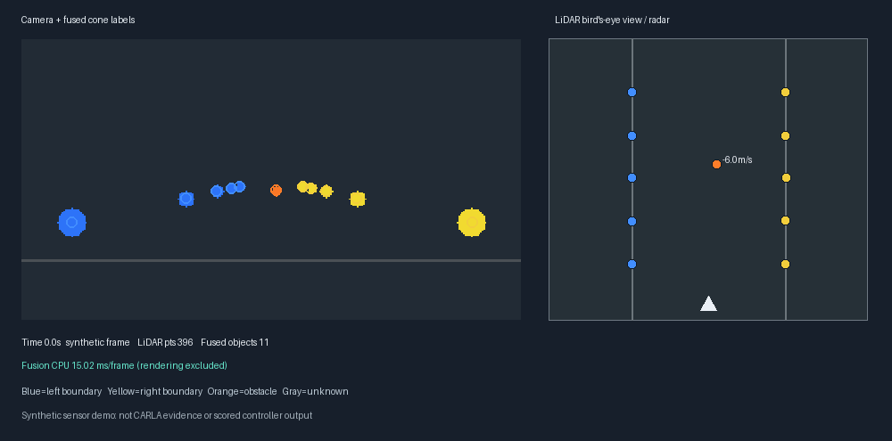
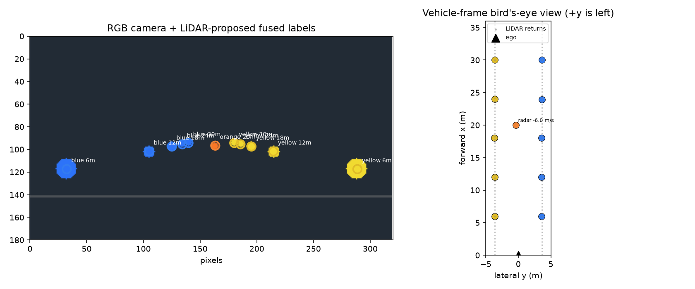
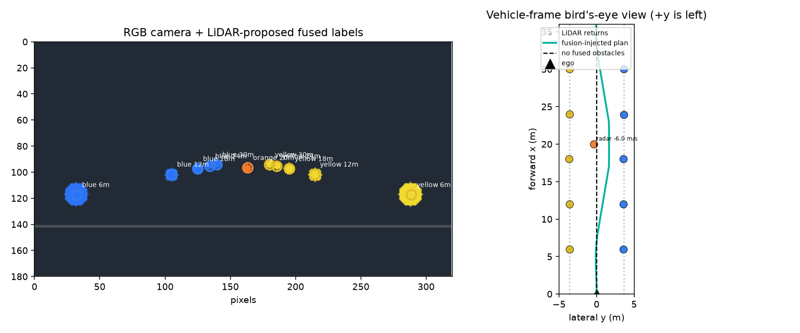

# Sensor fusion prototype

An offline **camera + LiDAR + radar** perception front end for the controller. The competition's sandbox hands the
controller an already-processed road model, so this package isn't part of the scored submission. It shows how raw
sensor frames can become the same cone and obstacle inputs the controller consumes.



## Pipeline

| Step | Module | What it does |
|---|---|---|
| Frame format | [`schema.py`](schema.py) | `FrameBundle`: vehicle-frame LiDAR points, calibrated RGB image, optional radar detections, timestamps (`.npz`) |
| Synthetic data | [`synthetic.py`](synthetic.py) | Generates LiDAR / camera / radar frames of a cone-lined course at 20 Hz, so no CARLA or GPU is needed |
| Fusion | [`fuse.py`](fuse.py) | Ground filtering, grid-connected LiDAR clustering, camera projection and colour classification, nearest-neighbour radar association, confidence and per-stage timing |
| Bridge | [`bridge.py`](bridge.py) | Converts fused objects into the simulator's `ConeDetections` and projects obstacles onto the road model as `ObstacleInfo`, returning a new `Observation` |
| Demo and benchmark | [`demo.py`](demo.py) · [`animate.py`](animate.py) | Benchmark, comparison image, animation, and a snapshot through the full HackUAB controller |
| CARLA capture | [`carla_capture.py`](carla_capture.py) | Optional: records synchronised sensor frames from a running CARLA vehicle |

## Run it

From the repository root, with the simulator's Python:

```bash
simulator/.venv/bin/python -m pytest tests/test_fusion_starter.py -q
simulator/.venv/bin/python -m fusion.demo --frames 600 --png fusion_demo.png        # 30 s benchmark + image
simulator/.venv/bin/python -m fusion.demo --full-controller --frames 20             # through the real controller
simulator/.venv/bin/python -m fusion.animate --frames 120 --stride 3 --out fusion_demo.gif
```

On Windows use `simulator\.venv\Scripts\python.exe`. With a CARLA server running, `fusion.carla_capture --out
fusion_capture` records frames that `fusion.demo --recorded <file.npz>` replays.

## Measured (synthetic data)

- Fusion runs in about **1.4–1.7 ms** median per frame on one core.
- About **91 %** of cones get the exact colour within 0.5 m, with a median position error of about 1.5 cm.
- In the full-controller check, a fused obstacle changed the steering command with no fallback triggered.





These numbers are offline and synthetic. Accuracy on real or CARLA sensor data isn't certified.
